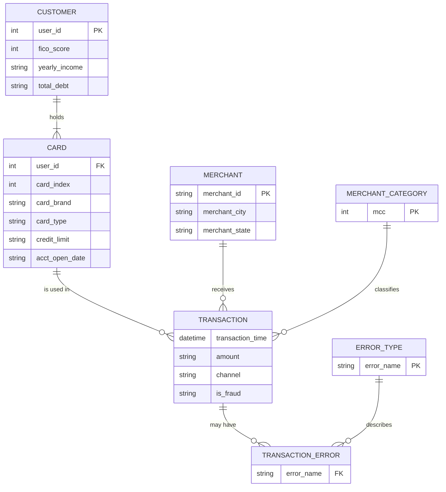

# Conceptual Data Model

This model describes the business entities in the card transaction data and how they relate. It has no data types or table design. Those come in the logical and physical models.

## Entities

| Entity | What it represents | Business key | Source |
|---|---|---|---|
| Customer | A cardholder | User ID (row position in the users file, 0 to 1999) | sd254_users |
| Card | A payment card issued to a customer. It also stands in for the account, because the data has no account entity. | Customer + card index | sd254_cards |
| Merchant | A business that receives payments, known only by an anonymised ID | Merchant ID (the Merchant Name field) | transactions |
| Merchant Category | Industry classification of a merchant (MCC) | MCC code | transactions |
| Transaction | One card transaction record, including those that report an error | None in the source. A key will be generated. | transactions |
| Error Type | A reason a transaction reports an error (7 types) | Error name | derived from Errors? |
| Transaction Error | Which errors occurred on which transaction | Transaction + error type | derived from Errors? |

## Relationships

- A customer holds one or more cards. Every customer in the data has at least one.
- A card is used in zero or more transactions. 7 of 6,146 cards have none.
- Each transaction is made on exactly one card, at one merchant, under one merchant category code.
- A merchant receives many transactions.
- A transaction has zero, one or several errors. An error type applies to many transactions. This many-to-many relationship is resolved by the Transaction Error entity.

## Business rules observed in the data

- A transaction takes place through one of three channels: swipe, chip or online.
- Amounts can be negative (5.1% of transactions).
- Each transaction carries a fraud flag (Yes/No). About 0.122% are fraud.
- US merchants have a state code and a zip. Foreign merchants have a country name where the state would be and no zip. Online merchants have neither.
- A customer ID is the row position in the users file, not a stored column.

## Open questions for the logical model

1. Does a merchant ID always have the same city, state, zip and MCC?
2. Is there a natural unique key for transactions, or must it be generated?
3. Do merchant location details belong to the merchant or to the transaction?

## Diagram

