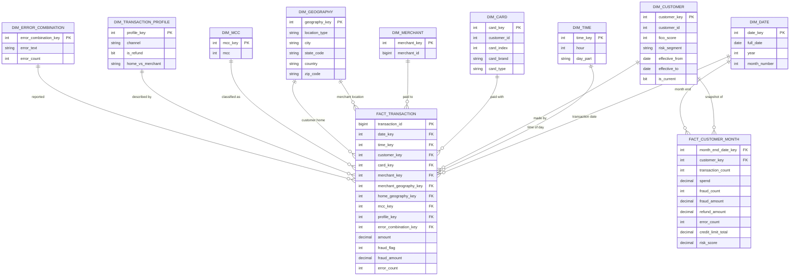

# Dimensional Model (dw schema)

A star schema built from the `core` tables. `core` is normalised for correct storage. `dw` is denormalised for analytical queries and for the Power BI semantic model. All warehouse keys are generated surrogate keys. Every dimension has an "Unknown" member with key -1.

## Fact tables

### fact_transaction (transaction fact)

**Business process:** a card transaction.
**Grain:** one row per card transaction (about 24.4 million rows).

| Column | Type of column | Notes |
|---|---|---|
| transaction_id | Degenerate dimension | From core.card_transaction.transaction_id. No dimension table. |
| date_key | FK to dim_date | Transaction date |
| time_key | FK to dim_time | Minute of day |
| customer_key | FK to dim_customer | The version valid on the transaction date |
| card_key | FK to dim_card | |
| merchant_key | FK to dim_merchant | |
| merchant_geography_key | FK to dim_geography | Role: where the merchant is |
| home_geography_key | FK to dim_geography | Role: where the customer lives |
| mcc_key | FK to dim_mcc | |
| profile_key | FK to dim_transaction_profile | Junk dimension |
| error_combination_key | FK to dim_error_combination | |
| amount | Additive measure | Signed. Negative values are refunds or similar |
| fraud_flag | Additive measure | 1 or 0, so a sum is the fraud count |
| fraud_amount | Additive measure | amount where fraud_flag = 1, else 0 |
| error_count | Additive measure | Number of errors on the transaction |

Ratios such as fraud rate and average amount are **non-additive**. They are always calculated as a ratio of sums, in DAX or SQL, and never stored.

### fact_customer_month (periodic snapshot)

**Business process:** monthly customer activity and risk.
**Grain:** one row per customer per calendar month with activity (at most about 720,000 rows).

| Column | Notes |
|---|---|
| month_end_date_key | FK to dim_date |
| customer_key | FK to dim_customer |
| transaction_count, spend, fraud_count, fraud_amount, refund_amount, error_count | Additive across customers and across months |
| credit_limit_total | Semi-additive: can be summed across customers, not across months |
| risk_score | Non-additive |

This table is small enough to load into Power BI directly. It is built in the segmentation phase, after the risk score exists.

## Dimension tables

| Dimension | Business key | Main attributes | SCD |
|---|---|---|---|
| dim_date | date | Year, quarter, month, week, day name, weekend flag, partial-year flag (2020). Range 1991-01-01 to 2020-12-31 | None (static) |
| dim_time | minute of day | Hour, minute, day part (night, morning, afternoon, evening) | None (static) |
| dim_customer | customer_id | Birth year, age band, gender, retirement age, income, debt, FICO score and FICO band, risk segment | Type 1 for descriptive attributes. Type 2 for risk_segment (effective_from, effective_to, is_current) |
| dim_card | customer_id + card_index | Brand, type, has chip, credit limit and band, account open year, cards issued, PIN last changed year, on dark web | Type 1 |
| dim_merchant | merchant_id | Merchant ID, location count (single or multi-location) | Type 1 |
| dim_geography | location_id | Location type (US, foreign, online), city, state, country, zip, per-capita income | Type 1 |
| dim_mcc | mcc | MCC code. Descriptions will come from a public reference list. They are not in the source and will not be invented | Type 1 |
| dim_transaction_profile (junk) | channel + flags | Channel, is_refund, channel_city_mismatch, home_vs_merchant (Online, Same state, Other US state, International). 48 rows | None |
| dim_error_combination | error string | Combination text, a flag per error type (7), error count. 24 rows including "No error" | None |

**Hierarchies:** date (year, quarter, month, day), geography (country, state, city, zip), customer age band, FICO band.

## Design decisions

- **Star, not snowflake.** Dimensions are denormalised and not split further. That means fewer joins, simpler DAX and better Power BI performance. The cost is some repeated text, which is trivial at these sizes.
- **Role-playing geography.** The same dim_geography table is related twice to the fact (merchant location and home location). In Power BI one relationship is active and the other is inactive, and we switch between them with USERELATIONSHIP in DAX.
- **SCD Type 2 only where history exists.** The source has no change history, so there is nothing to track in most attributes. Risk segment is derived by our own monthly scoring and does change, so it is the Type 2 attribute. Until scoring exists, each customer has one current row.
- **No accumulating snapshot, no factless fact.** The data has no lifecycle stages and no events without measures.
- **Late-arriving dimensions** are not expected, because foreign keys in core guarantee every transaction has its dimension rows. The Unknown member (key -1) is a safeguard.
- **Power BI volume.** The detailed fact stays in SQL Server. Power BI will use aggregated tables and fact_customer_month because of the memory limit. The details are decided in the Power BI phase.

## Diagram

