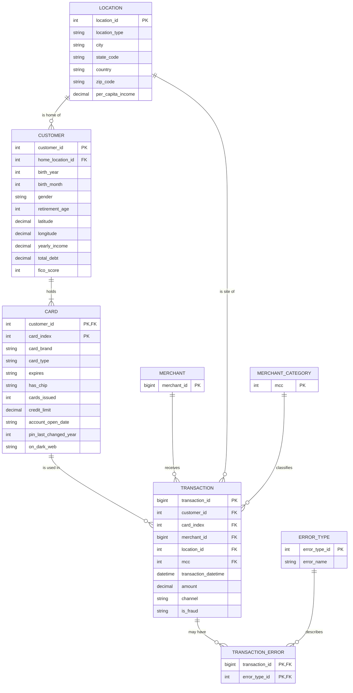

# Logical Data Model

A normalised (3NF) relational model built from the conceptual model and the dependency tests in `notebooks/01_data_understanding.ipynb`. Names here are logical. Physical names and data types come in the physical model.

## Dependencies tested

| Dependency | Result | Decision |
|---|---|---|
| merchant to city, state, zip | Fails for 23,504 of 100,343 merchants | Location is its own entity |
| merchant to MCC | Fails for 654 merchants (0.65%) | MCC stays on the transaction |
| zip to city and state (merchant data) | 27,321 locations with a zip, 27,321 distinct zips | Zip is a candidate key of location |
| zip to per-capita income (customers) | 0 conflicts across 173 shared zips | Stored on location |
| zip to city, state (customers) | 0 conflicts across 173 shared zips | Customer home becomes a location |
| birth year + month to current age | 0 conflicts | Current age is derived, not stored |
| customer to card count | Matches Num Credit Cards for 2,000 of 2,000 | Num Credit Cards is derived, not stored |

## Tables

### customer
Key: customer_id (row position in the users file).

| Column | Notes |
|---|---|
| customer_id | PK |
| home_location_id | FK to location |
| birth_year, birth_month | |
| gender | Descriptive use only, not in risk scoring |
| retirement_age | |
| latitude, longitude | Home coordinates |
| yearly_income, total_debt | |
| fico_score | |

### card
Key: (customer_id, card_index).

| Column | Notes |
|---|---|
| customer_id | PK, FK to customer |
| card_index | PK |
| card_brand, card_type | |
| expires | Month and year |
| has_chip | |
| cards_issued | |
| credit_limit | |
| account_open_date | |
| pin_last_changed_year | |
| on_dark_web | Flag |

### location
Key: location_id (generated). Alternate key: zip_code, for US locations.

| Column | Notes |
|---|---|
| location_id | PK |
| location_type | US, FOREIGN or ONLINE |
| city | |
| state_code | US locations only |
| country | Foreign locations only |
| zip_code | US locations only, unique, 5 characters |
| per_capita_income | Known only for customer zips |

### merchant
Key: merchant_id. The table is thin on purpose: no source attribute depends on the merchant alone.

### merchant_category
Key: mcc. No description column in the source.

### transaction
Key: transaction_id (generated, the source has none).

| Column | Notes |
|---|---|
| transaction_id | PK |
| customer_id, card_index | Composite FK to card |
| merchant_id | FK to merchant |
| location_id | FK to location |
| mcc | FK to merchant_category |
| transaction_datetime | Built from Year, Month, Day, Time |
| amount | Signed. Negative values are kept |
| channel | Swipe, Chip or Online |
| is_fraud | |

### error_type
Key: error_type_id. 7 rows: Bad CVV, Bad Card Number, Bad Expiration, Bad PIN, Bad Zipcode, Insufficient Balance, Technical Glitch.

### transaction_error
Key: (transaction_id, error_type_id). Resolves the many-to-many relationship between transactions and errors.

## Normalisation

**1NF.** The source Errors? column held several values in one field (24 distinct strings made from 7 base types). That is split into error_type and transaction_error. The date arrives in three columns plus a text time. These become one transaction_datetime.

**2NF.** The tables with composite keys are card and transaction_error. In both, every non-key column depends on the whole key. If card held the customer's FICO score, it would depend only on customer_id (part of the key), which is a 2NF violation. That is why the score lives in customer.

**3NF.** Removed or moved:
- current_age: derived from birth year and month.
- num_credit_cards: derived from the card count.
- city, state and per-capita income: moved off customer, because the zip determines them.

In location, city, state and income depend on zip_code, which is a candidate key for US rows. 3NF permits dependencies on any candidate key.

## Not carried into the model

Person (name), Address, Apartment, Card Number and CVV. They are personal or sensitive and have no analytical use here.

## To verify in SQL (Phase 8)

1. Is (customer, card, datetime, merchant, amount) unique, or are there duplicate transactions?
2. Do customer home cities match merchant location cities for the same zip?
3. Are all 2-character merchant states valid US state or territory codes?

## Diagram

